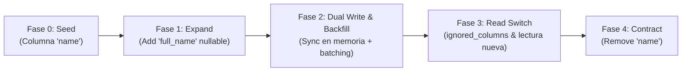

# Zero-Downtime Database Migrations Lab (Rails & SQLite)

Laboratorio práctico e interactivo diseñado para simular y demostrar el ciclo completo del patrón **Expand & Contract** (Parallel Run) en migraciones de bases de datos con alto tráfico, garantizando **cero tiempo de inactividad** (_zero downtime_) y evitando bloqueos de lectura/escritura o errores de cache de esquema.

---

## 🎯 Objetivo de la Simulación

En sistemas de alta concurrencia, realizar un renombrado directo de columnas (`RENAME COLUMN`) o ejecutar un `UPDATE` masivo bloquea tablas (`Exclusive Locks`), satura el ancho de banda de replicación y desincroniza el cache de modelos en memoria (`schema cache`) entre servidores que corren versiones distintas de la aplicación.

Este laboratorio demuestra cómo desacoplar los cambios de esquema en **4 despliegues progresivos y seguros** utilizando ActiveRecord y SQLite como motor SQL relacional real.



---

## 📋 Requisitos Previos

- **Ruby**: 3.2+ o 4.0+ (Gestionado vía `.tool-versions` o `.ruby-version` con `asdf` / `rbenv`).
- **SQLite3**: Incluido por defecto en la mayoría de entornos Unix/macOS.
- **Bundler**: Gestionado automáticamente de forma declarativa con `bundler/inline` o mediante `bundle install`.

---

## 🚀 Guía de Ejecución Paso a Paso

### 0. Inicialización (`seed`)
Crea la base de datos `demo_production.sqlite3`, la tabla `users` y siembra 1.000 registros históricos con la columna original `:name`.

```bash
ruby zero_downtime_lab.rb seed
```

---

### 1. Despliegue 1: Expand (`phase1`)
Agrega la nueva columna `:full_name` permitiendo valores `NULL`.
- **Por qué**: Una columna `nullable` sin valor por defecto no requiere reescritura de tabla ni bloqueos destructivos prolongados.
- **Estado de la App**: Sigue leyendo y escribiendo en `:name`.

```bash
ruby zero_downtime_lab.rb phase1
```

---

### 2. Despliegue 2: Dual Write & Backfill (`phase2`)
1. **Dual Write**: Los nuevos registros o actualizaciones escriben simultáneamente en `:name` y `:full_name`.
2. **Backfill en Lotes (`each_slice`)**: Itera sobre IDs pendientes con consultas segmentadas para migrar el histórico sin saturar I/O ni causar lag en réplicas.

```bash
ruby zero_downtime_lab.rb phase2
```

---

### 3. Despliegue 3: Read Switch & Cache Shield (`phase3`)
1. **Lectura**: La aplicación comienza a leer exclusivamente de `:full_name`.
2. **`ignored_columns`**: Se instruye a ActiveRecord para ignorar `:name` en consultas `SELECT users.*`.
- **Por qué**: Si se dropea una columna mientras instancias de la app aún la esperan en su cache de esquema, fallarán con `ActiveModel::MissingAttributeError`.

```bash
ruby zero_downtime_lab.rb phase3
```

---

### 4. Despliegue 4: Contract (`phase4`)
Elimina la columna obsoleta `:name` de la base de datos.
- **Por qué**: En este punto ningún servidor en producción referencia `:name`, por lo que el cambio de DDL es 100% seguro y transparente.

```bash
ruby zero_downtime_lab.rb phase4
```

---

## 🔍 Comandos de Utilidad

### Consultar el estado de la base de datos
Permite inspeccionar en cualquier momento las columnas activas, el total de registros y los datos poblados:

```bash
ruby zero_downtime_lab.rb status
```

### Reiniciar el entorno local
Elimina el archivo `demo_production.sqlite3` para recomenzar el laboratorio desde cero:

```bash
ruby zero_downtime_lab.rb reset
```

---

## 📚 Créditos y Referencias

- **Patrón de Arquitectura**: *Parallel Run / Expand and Contract Pattern* (Martin Fowler).
- **Guías Oficiales Rails**: *Active Record Basics & Database Migrations*.
- **Herramienta Recomendada**: [ankane/strong_migrations](https://github.com/ankane/strong_migrations) para detectar operaciones inseguras en tiempo de desarrollo.
